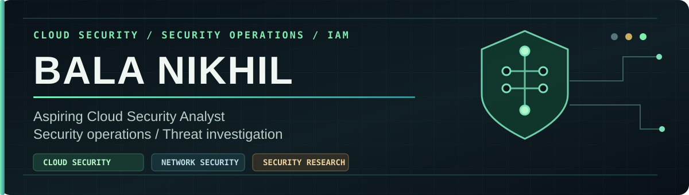

  

<h2 align="center">Hi, I'm Bala Nikhil 👋</h2>

  <strong>Aspiring Cloud Security Analyst &nbsp;•&nbsp; IAM &amp; Network Security &nbsp;•&nbsp; AI Security Research</strong>

  Focused on securing cloud-connected systems through <strong>identity and access management, network security, secure APIs, and practical security engineering</strong>. Building hands-on research projects and developing AWS/Azure cloud security skills.

  <a href="https://github.com/Nikhilbal/synthshield"><b>🛡️ Flagship Project</b></a>
  &nbsp;·&nbsp;
  <a href="https://bala-nikhil-portfolio.vercel.app">🌐 Portfolio</a>
  &nbsp;·&nbsp;
  <a href="https://www.linkedin.com/in/bala-nikhil-91225b287/">💼 LinkedIn</a>
  &nbsp;·&nbsp;
  <a href="https://github.com/Nikhilbal?tab=repositories">📂 Repositories</a>

---

## 🛡️ Featured: SYNTHSHIELD

### [Coalition-Aware Security Gateway for Autonomous AI Agents](https://github.com/Nikhilbal/synthshield)

**Problem:** An AI agent can combine individually accessible records from multiple tools and potentially infer confidential information.

**Solution:** A trusted, credential-verified gateway checks source permissions, approved purpose, and cross-source inference risk **before** executing protected tools.

<table>
  <tr>
    <th align="center">106 / 106</th>
    <th align="center">4 / 4</th>
    <th align="center">5 / 5</th>
  </tr>
  <tr>
    <td align="center">Automated tests passed</td>
    <td align="center">Control-isolation cases passed</td>
    <td align="center">Deployed-boundary checks passed</td>
  </tr>
</table>

  
   
  Retro-style <b>recorded security evidence</b> dashboard. This is not live SOC telemetry.

**Technical highlights**
- Scoped Bearer credentials, purpose-based access controls, and independent risk evaluation.
- Counterfactual coalition analysis with a rule-based sensitive-inference detector.
- Isolated Docker agent workflows, FastAPI tool/policy APIs, and PostgreSQL authorization state.
- Controlled prompt-injection trials and grounded handling of denied data.

**Observed in the local experiment:** authorized finance/travel requests returned **HTTP 200**, unauthorized calendar access returned **HTTP 403**, and no unauthorized calendar execution was observed in the tested runs.

`Python` · `FastAPI` · `PostgreSQL` · `Docker` · `Ollama` · `Pytest`

  <a href="https://github.com/Nikhilbal/synthshield"><b>Explore source & setup →</b></a>
  &nbsp;·&nbsp;
  <a href="https://github.com/Nikhilbal/synthshield/blob/main/reports/phase12/technical_documentation.md">Architecture & research notes</a>
  &nbsp;·&nbsp;
  <a href="https://github.com/Nikhilbal/synthshield/blob/main/reports/phase12/security_findings.md">Security findings</a>

> **Research scope:** SYNTHSHIELD uses synthetic datasets. Results describe specific local tests, not a production certification. Generalized inference detection, context attribution, and legacy-path hardening remain open work.

---

## 👨‍💻 About me

I'm an **Electronics & Communication Engineering graduate** working toward a career as a **Cloud Security Analyst**. My learning focuses on **cloud IAM, network security, least-privilege architecture, secure APIs, and security monitoring**, supported by hands-on labs and security research projects.

I enjoy connecting security principles with working systems: defining a threat, building the control, testing it under normal and adversarial conditions, and documenting what the evidence actually supports.

**Target roles:** Cloud Security Analyst internships, cloud/security operations internships, and junior security engineering opportunities. I'm strengthening my AWS/Azure foundations alongside networking and Linux security.

## 🚀 Selected projects

<table>
  <tr>
    <td width="50%" valign="top">
      <h3>🚘 <a href="https://github.com/Nikhilbal/poolgo-app">PoolGo</a></h3>
      
<b>Carpooling mobile application MVP</b> Ride matching, booking flows, and mobile-to-backend integration.

      
<code>React Native</code> <code>Node.js</code> <code>JavaScript</code>

      <a href="https://github.com/Nikhilbal/poolgo-app">App →</a> · <a href="https://github.com/Nikhilbal/poolgo-backend">Backend →</a>
    </td>
    <td width="50%" valign="top">
      <h3>🛒 <a href="https://github.com/Nikhilbal/Ai-smartcart-billing">Smart Cart Billing</a></h3>
      
<b>Retail self-checkout prototype</b> Mobile billing, API services, an admin interface, and example IoT verification flows.

      
<code>TypeScript</code> <code>Node.js</code> <code>PostgreSQL</code>

      <a href="https://github.com/Nikhilbal/Ai-smartcart-billing">Explore project →</a>
    </td>
  </tr>
  <tr>
    <td width="50%" valign="top">
      <h3>📊 <a href="https://github.com/Nikhilbal/customer-360">Customer 360</a></h3>
      
<b>Analytics & ML dashboard</b> Exploratory customer segmentation and behavior analysis.

      
<code>Python</code> <code>Streamlit</code> <code>K-Means</code>

      <a href="https://github.com/Nikhilbal/customer-360">Explore project →</a>
    </td>
    <td width="50%" valign="top">
      <h3>🤖 <a href="https://github.com/Nikhilbal/Smartspark">SmartSpark</a></h3>
      
<b>Full-stack AI chat application</b> Conversational user interface and API-backed architecture.

      
<code>React</code> <code>FastAPI</code> <code>MongoDB</code>

      <a href="https://github.com/Nikhilbal/Smartspark">Explore project →</a>
    </td>
  </tr>
</table>

## ⚙️ Technical focus

| Area | Tools and concepts |
| --- | --- |
| 🛡️ **Security engineering** | IAM/RBAC, least privilege, API authorization, audit trails, prompt-injection evaluation |
| 🌐 **Networking & systems** | TCP/IP fundamentals, Linux, Wireshark, Kali/Ubuntu security labs, Docker isolation |
| 🧑‍💻 **Development** | Python, Java, JavaScript/TypeScript, SQL, FastAPI, Node.js, REST APIs |
| 🗄️ **Data & platforms** | PostgreSQL, Streamlit, Git/GitHub, local Ollama models |
| 📚 **Currently learning** | AWS/Azure cloud security fundamentals, cloud IAM, cloud logging/monitoring, network security, and adversarial testing |

## 🔍 How I work

`Threat model` → `Build a control` → `Test normal behavior` → `Test abuse cases` → `Document evidence & limitations`

---

  <b>Aspiring Cloud Security Analyst — open to relevant internships, early-career security opportunities, and technical collaboration.</b>

  <a href="https://www.linkedin.com/in/bala-nikhil-91225b287/">Connect on LinkedIn</a>
  &nbsp;·&nbsp;
  <a href="https://bala-nikhil-portfolio.vercel.app">View portfolio</a>
  &nbsp;·&nbsp;
  <a href="https://github.com/Nikhilbal/synthshield">See SYNTHSHIELD</a>

